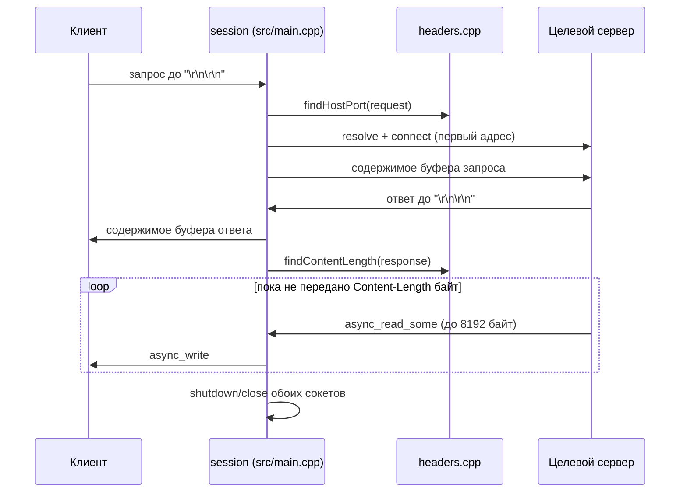

# AsyncHttpProxy — документация

Учебный проект 7-го спринта курса «Мидл разработчик С++» (`README.md:9`): асинхронный
HTTP-прокси на Boost.Asio с корутинами C++20. Программа принимает TCP-соединение от
клиента, читает заголовки HTTP-запроса, по заголовку `Host` подключается к целевому
серверу, пересылает ему запрос и возвращает клиенту ответ (`src/main.cpp:32-92`).
Кто, кроме автора и проверяющих курса, пользуется проектом, из кода не следует.

## Статус

- Последний коммит: `40d9bae` «v1.0.1», 2025-09-02 (`git log`). Всего три коммита:
  шаблон курса (`64983d0`), `v1.0.0`, `v1.0.1`.
- Тесты есть: 7 тестов GoogleTest на разбор заголовков (`tests/headers_test.cpp`).
  Код сессии прокси (`src/main.cpp`) тестами не покрыт.
- CI в репозитории нет (нет каталогов `.github/` или `.gitea/`).
- Незавершённость видна по коду: поддерживается один запрос на соединение, тело
  ответа пересылается только при наличии `Content-Length` (см. «Известные ограничения»).

## Структура

| Путь | Назначение |
|---|---|
| `CMakeLists.txt` | Сборка: библиотека `AsyncHttpProxy_imp`, программа `AsyncHttpProxy`, тесты `AsyncHttpProxy_tests` |
| `include/headers.h` | Объявления `HostPort`, `iterHeaders`, `findHostPort`, `findContentLength` |
| `src/headers.cpp` | Разбор HTTP-заголовков на `std::views` |
| `src/main.cpp` | Сервер (`Server`), корутина `session`, `main` |
| `tests/headers_test.cpp` | Тесты `findHostPort` и `findContentLength` |
| `tests/main.cpp` | Точка входа GoogleTest |
| `.devcontainer/` | Dockerfile и `devcontainer.json` окружения разработки; `default` — профиль Conan (gcc 15, `gnu26`) |
| `.clang-format` | Стиль кода (LLVM, ширина 120, отступ 4) |

## Архитектура

Один процесс, один поток: `io_service io_service(1)` и `io_service.run()`
(`src/main.cpp:134-136`). `Server` асинхронно принимает соединения на IPv4-порту и для
каждого запускает корутину `session` через `co_spawn(..., detached)`
(`src/main.cpp:106-119`).



Внешних сервисов, кроме DNS-резолвера ОС и целевых HTTP-серверов, нет.

## Сборка и запуск

Требования (из `CMakeLists.txt` и `.devcontainer/Dockerfile`):

- CMake ≥ 3.31.6 (`CMakeLists.txt:1`);
- компилятор с поддержкой C++26 и `<print>` (`CMakeLists.txt:4`); в контейнере — `g++-15`
  (`.devcontainer/Dockerfile:5,10`);
- Boost (Asio, Beast) — `find_package(Boost REQUIRED)` (`CMakeLists.txt:20`), в контейнере
  пакет `libboost-all-dev`;
- GoogleTest — `find_package(GTest REQUIRED)` (`CMakeLists.txt:21`), пакет `libgtest-dev`.

Версии Boost и GTest в файлах не закреплены. Окружение рассчитано на VS Code Dev
Containers (`README.md:11-18`, `.devcontainer/devcontainer.json`).

Сборка (`README.md:37-40`):

```bash
mkdir build && cd build
cmake ..
make
```

Флаги `-Wfatal-errors -Wall -Werror` для GCC/Clang (`CMakeLists.txt:9-12`): любое
предупреждение ломает сборку.

Запуск с проверкой (`README.md:44-52`):

```bash
cd build
./AsyncHttpProxy 5555 &
python3 -c 'print("HTTP/1.1 200 OK\r\nContent-Type: text/html\r\nContent-Length: 4096\r\n\r\n" + "A"*4096, end="")' | nc -l 127.0.0.1 -p 8000 &
wget -e use_proxy=yes -e http_proxy=127.0.0.1:5555 127.0.0.1:8000
```

## Конфигурация

Переменных окружения и конфигурационных файлов программа не читает.

| Параметр | Значение | Источник |
|---|---|---|
| `argv[1]` (`<listen_port>`) | Порт прослушивания на всех IPv4-адресах; обязателен, иначе вывод `Usage: proxy_server <listen_port>` и код 1 | `src/main.cpp:129-135` |

Порт разбирается `std::atoi` и передаётся как `short` (`src/main.cpp:97,135`).

## Использование

Клиент настраивает прокси `127.0.0.1:<listen_port>` и отправляет обычный HTTP/1.1-запрос
с заголовком `Host`. Если `Host` без порта, используется `80` (`src/headers.cpp:44-45`).
Если `Host` отсутствует, в stdout печатается `Could not find host in request`, соединение
закрывается (`src/main.cpp:46-48`). Ошибки сессии печатаются как `Session error: ...`
в stderr и stdout (`src/main.cpp:81-85`).

## Тестирование

```bash
cd build
./AsyncHttpProxy_tests
```

(`README.md:57-60`). Тест также зарегистрирован в CTest как `AsyncHttpProxy_Tests`
(`CMakeLists.txt:55-56`).

Покрытие (`tests/headers_test.cpp`): `findHostPort` — хост с портом, без порта (порт 80),
без `Host`; `findContentLength` — корректное значение, отсутствие заголовка, переполнение
`size_t`, нечисловое значение. Сетевой код не тестируется.

## Известные ограничения и проблемы

Выведено из чтения кода, не из запуска:

- Один запрос на соединение: после ответа оба сокета закрываются (`src/main.cpp:87-91`).
- Тело запроса клиента пересылается только в объёме, уже прочитанном в буфер вместе с
  заголовками (`src/main.cpp:38,55`); `Content-Length` запроса не учитывается.
- Без `Content-Length` в ответе (например, `Transfer-Encoding: chunked`) клиенту уходит
  только то, что попало в буфер при чтении заголовков (`src/main.cpp:65-78`).
- `async_read_until` может прочитать часть тела вместе с заголовками; эти байты уходят
  клиенту (`src/main.cpp:65`), но цикл всё равно ждёт полные `Content-Length` байт
  (`src/main.cpp:69-77`). Если сервер не закроет соединение, сессия ждёт. Если за один
  `read_some` придёт больше, чем осталось, `bytes_to_transfer -= n` переполнит `size_t`
  (`src/main.cpp:76`).
- Имена заголовков сравниваются с учётом регистра (`"Host"`, `"Content-Length"`), разделитель
  строго `": "` (`src/headers.cpp:20,38,55`).
- `Host` с IPv6-адресом (`[::1]:8080`) будет разрезан по первому `:` (`src/headers.cpp:39`).
- Используется только первый адрес из резолвера (`src/main.cpp:53`).
- Порт > 32767 не помещается в `short` (`src/main.cpp:97`); при передаче в `tcp::endpoint`
  значение снова приводится к беззнаковому типу порта, так что на практике такой порт, вероятно,
  работает (не проверено). Порт > 65535 обрезается; некорректный аргумент даёт 0 (ОС выбирает
  свободный порт).
- `src/main.cpp` компилируется и в библиотеку `_imp`, и в исполняемый файл
  (`CMakeLists.txt:26-29,39-41`); `GLOB include/*.hpp` не находит `headers.h`
  (`CMakeLists.txt:22`). На сборку это, по чтению, не влияет, но выглядит как остаток шаблона.
- `src/headers.cpp` вызывает `std::from_chars` без явного `#include <charconv>`
  (`src/headers.cpp:1-5,57`).

## Связанные документы

- [../README.md](../README.md) — исходный README курса
- [../SPEC.md](../SPEC.md) — спецификация требований
- [../LICENSE](../LICENSE) — лицензия

## Об этом документе

Написан 2026-11-18 по коммиту `40d9bae`. Выполнялись только чтение файлов и
`git ls-files`, `git log`, `git show --stat`. Сборка, тесты и запуск прокси **не
выполнялись**: утверждения о поведении выведены из исходного кода.
